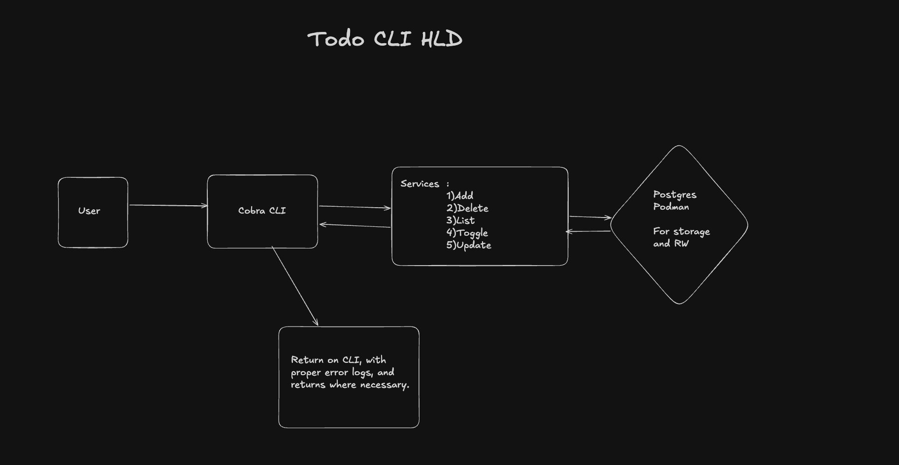

# todo

A command-line todo app written in Go. It uses [Cobra](https://github.com/spf13/cobra) for the CLI and PostgreSQL (run with Podman) for storage.

## High-Level Design



1. The user runs a command through the Cobra CLI.
2. The CLI calls the service layer (Add, Delete, List, Toggle, Update).
3. The service reads and writes todos in PostgreSQL.
4. The result or error goes back to the CLI, which prints it.

## Requirements

- [Go](https://go.dev/dl/) 1.27 or newer
- [Podman](https://podman.io/) with `podman compose` (on macOS: `brew install podman podman-compose`)

## Setup

**1. Start Podman (macOS/Windows only)**

```
podman machine start
```

**2. Create your `.env` file**

```
cp .env.example .env
```

Open `.env` and set your own `POSTGRES_PASSWORD`. Then update the password in `DATABASE_URL` to match.

> If your password has special characters (such as `/` or `@`), URL-encode it in `DATABASE_URL` (`/` becomes `%2F`, `@` becomes `%40`). A password with only letters and numbers avoids this.

**3. Create the data folder**

The database files are stored on your Desktop, so you can delete them by moving the folder to Trash.

```
mkdir -p ~/Desktop/volumes/todo/data
```

**4. Start the database**

```
podman compose up -d
podman compose ps
```

Wait until the status shows `healthy`.

## Usage

Build the app, then run it:

```bash
go build -o bin/todo ./cmd/todo

./bin/todo add "buy milk"
./bin/todo list
./bin/todo toggle 1
./bin/todo update 1 "buy oat milk"
./bin/todo delete 1
```

| Command | What it does |
|---|---|
| `add <title>` | Add a todo |
| `list` | Show all todos (`[x]` means done) |
| `toggle <id>` | Mark done, or not done if it already is |
| `update <id> <title>` | Change the title |
| `delete <id>` (or `rm`) | Delete a todo |

Run `./bin/todo --help` for details. The table is created automatically on first run.

## Tests

```bash
go test ./... -race
```

## Database commands

| Command | What it does |
|---|---|
| `podman compose up -d` | Create and start the database in the background |
| `podman compose ps` | Show the status |
| `podman compose logs -f` | Show the logs (press `Ctrl+C` to exit) |
| `podman compose stop` | Pause the database |
| `podman compose start` | Resume a paused database |
| `podman compose down` | Remove the container (your data is kept) |

## Where is my data?

In `~/Desktop/volumes/todo/data`, outside the container. `podman compose down` does not delete it.

To delete everything: run `podman compose down`, then move `~/Desktop/volumes/todo` to Trash.
